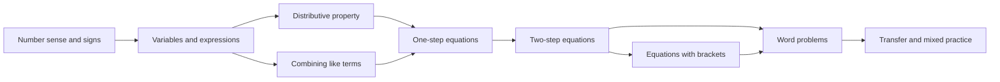
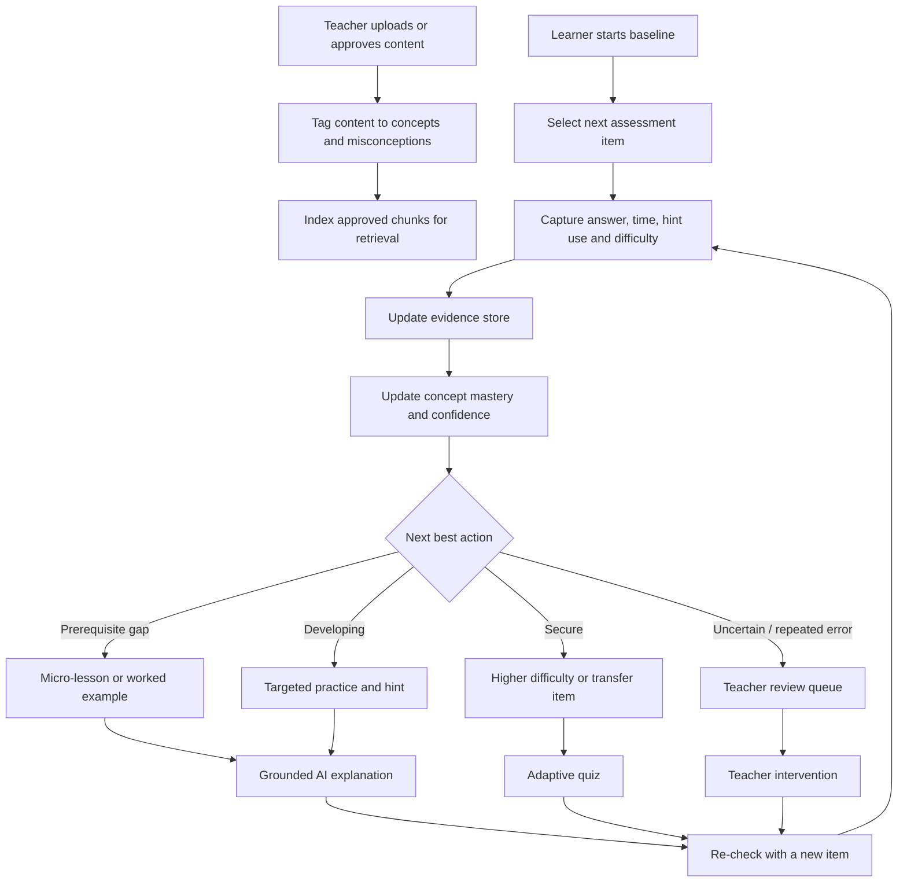
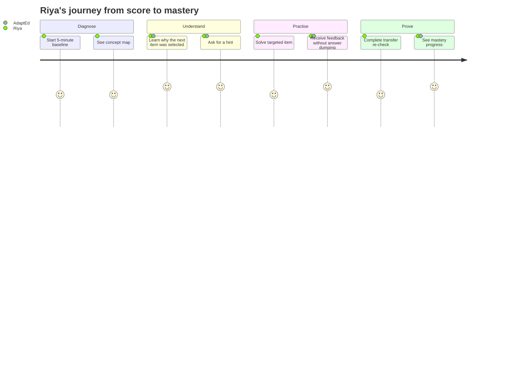
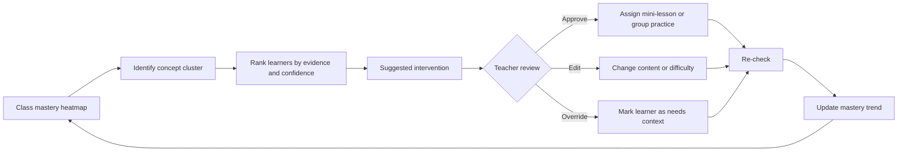
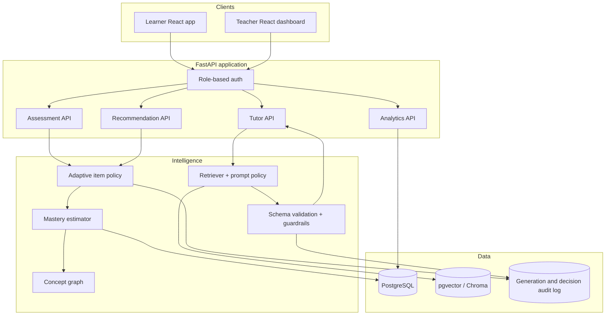

# PS-22 Diagram and Product Asset Pack

Use this file as the construction kit for the PPT and prototype. The diagrams are written in Mermaid where possible so the team can render them in Mermaid Live, draw.io, Figma, PowerPoint or Canva. The same structures can be simplified into slide visuals.

---

## 1. Core concept graph for the recommended MVP

The graph should be small enough for the hackathon and explicit enough to support diagnosis.

### Algebra concept graph



### Concept record

Store each concept with:

```json
{
  "id": "ALG-DIST-01",
  "name": "Distributive property",
  "grade": 9,
  "subject": "Mathematics",
  "prerequisites": ["ALG-VAR-01"],
  "common_misconceptions": [
    "multiplies only the first term",
    "loses the negative sign",
    "changes the operation inside the bracket"
  ],
  "mastery_threshold": 0.72,
  "approved_sources": ["lesson-algebra-03", "worked-example-07"]
}
```

### How to draw this on a slide

- Use five to seven nodes only on the visible slide.
- Make the selected gap coral, its prerequisites amber and mastered concepts teal.
- Put a small label such as `11 learners blocked here` beside a teacher-view graph.
- Add an arrow labelled `prerequisite` rather than leaving arrows unexplained.

---

## 2. End-to-end process flow

### Mermaid source



### Short version for a crowded slide

```text
Answer → Evidence → Mastery map → Next best action → Re-check
                      ↓
                Teacher intervention
```

The short version should be used on the main deck; keep the full version in an appendix or speaker notes.

---




### Slide-ready user journey labels

1. **Baseline:** “What do I know right now?”
2. **Diagnosis:** “Which concept is blocking me?”
3. **Guidance:** “Can you explain it at my level?”
4. **Practice:** “Give me one useful next question.”
5. **Proof:** “Can I use it in a new problem?”
6. **Progress:** “What should I learn next?”

---

## 4. Teacher intervention loop



### Recommended dashboard modules

```text
┌───────────────────────────────┐  ┌──────────────────────────┐
│ Class mastery heatmap           │  │ Intervention queue        │
│ concept × learner               │  │ 1. Distributing signs    │
│ green / amber / coral           │  │ 2. Two-step equations    │
└───────────────────────────────┘  └──────────────────────────┘

┌───────────────────────────────┐  ┌──────────────────────────┐
│ Progress trend                  │  │ AI content review         │
│ before → practice → re-check    │  │ approve / edit / reject   │
└───────────────────────────────┘  └──────────────────────────┘
```

---

## 5. Technical architecture diagram



### What to say when presenting it

> The frontend has two role-specific surfaces, but both read from a shared evidence and mastery model. The adaptive policy selects items deterministically, the mastery service estimates the learner state, and the RAG tutor generates language from approved material. Every recommendation and generation event is auditable.

---

## 6. Suggested database entities

Keep the schema small in the prototype. These entities are enough to support the demo.

```text
users
  id, role, display_name, grade, language, created_at

subjects
  id, name, curriculum_code

concepts
  id, subject_id, name, description, mastery_threshold

concept_edges
  prerequisite_id, dependent_id, edge_type

items
  id, concept_id, difficulty, question, options, answer, explanation,
  misconception_tag, source_id, approved_by, status

attempts
  id, user_id, item_id, answer, is_correct, response_ms,
  hint_count, confidence_signal, created_at

mastery_states
  user_id, concept_id, score, confidence, evidence_count, trend, updated_at

recommendations
  id, user_id, concept_id, action_type, reason, priority,
  evidence_ids, status, created_at

content_chunks
  id, source_id, concept_id, text, embedding, approval_status

interventions
  id, teacher_id, learner_id_or_group_id, concept_id,
  action, teacher_status, outcome, created_at

audit_events
  id, actor_type, event_type, model_version, input_ref,
  output_ref, safety_flags, created_at
```

### Subject-wise and concept-wise reporting

The schema supports both levels required by PS-22:

```text
Subject summary
  subject_id, learner_id, overall_mastery, confidence, trend

Concept detail
  subject_id, concept_id, score, confidence, evidence_count,
  likely_misconception, next_action
```

The subject summary should be derived from the learner's concept states for that subject. It provides a high-level progress view, while the concept detail explains which prerequisite or misconception caused the summary and what the learner should do next. The teacher dashboard should support subject → concept drill-down, and the learner view should show the same hierarchy in a simpler form.

### Privacy guidance for the demo database

- Use synthetic names such as Riya, Arjun and Group B.
- Never commit real student records.
- Do not store raw chat transcripts unless required for the demo.
- Keep API keys in environment variables, never in screenshots or source control.
- Add a visible `demo data` label to presentation screenshots.

---

## 7. Adaptive-assessment pseudocode

```python
def choose_next_item(learner, concept_graph, item_bank):
    mastery = get_mastery(learner)
    uncertain = concepts_with_low_confidence(mastery)
    blocked = prerequisite_blockers(mastery, concept_graph)

    if blocked:
        target = highest_priority(blocked)
        return item_bank.best_item(
            concept=target,
            difficulty="easy_or_medium",
            misconception=likely_misconception(learner, target),
        )

    target = choose_concept_for_learning_gain(uncertain, mastery)
    if repeated_recent_error(learner, target):
        return item_bank.best_item(
            concept=target,
            difficulty="scaffolded",
            mode="worked_example_or_hint",
        )

    if mastery[target] >= 0.72 and low_hint_use(learner, target):
        return item_bank.best_item(concept=target, difficulty="hard_or_transfer")

    return item_bank.best_item(concept=target, difficulty="medium")
```

### What this proves

- The platform can adapt without a large neural model.
- The policy is inspectable by a teacher or judge.
- The LLM is not allowed to choose an arbitrary curriculum path.
- The same function can later be upgraded with a calibrated model.

---

## 8. Mastery-update example

### Example evidence

```text
Concept: Distributive property
Recent answers: wrong, wrong, correct, correct
Item difficulty: easy, medium, medium, medium
Hint usage: 2, 1, 1, 0
Transfer question: not attempted yet
```

### Interpretation

```text
Current state: developing
Confidence: medium
Likely misconception: negative sign is not distributed to all terms
Next action: visual worked example + one scaffolded question
Teacher flag: monitor; escalate only if the next re-check fails
```

### Why this is better than a binary label

The product should avoid declaring a learner permanently “weak.” Use a state with:

- mastery estimate;
- confidence / evidence count;
- likely misconception;
- next action;
- trend over time.

This is both more educationally respectful and technically more honest.

---

## 9. RAG tutor prompt contract

Do not expose a raw “ask the LLM anything” box in the prototype. Use a controlled tutor prompt.

### Input schema

```json
{
  "grade": 9,
  "subject": "Mathematics",
  "concept": "Distributive property",
  "learner_attempt": "-2(x + 3) = 8; I wrote -2x + 3 = 8",
  "requested_mode": "hint",
  "retrieved_sources": [
    {"id": "lesson-algebra-03", "text": "..."},
    {"id": "worked-example-07", "text": "..."}
  ]
}
```

### Output schema

```json
{
  "mode": "hint",
  "message": "When you multiply a bracket by -2, the -2 applies to every term inside it. Which term has not received the -2 yet?",
  "check_question": "Rewrite the first term after distributing -2.",
  "source_ids": ["lesson-algebra-03"],
  "confidence": "high",
  "needs_teacher_review": false,
  "safety_flags": []
}
```

### Prompt rules

1. Use only the retrieved approved content for factual explanation.
2. Never invent a source.
3. Match the learner’s grade and requested language.
4. Prefer a hint or leading question before a solution.
5. Do not shame, label or compare the learner.
6. If sources are missing or contradictory, return a teacher-review flag.
7. Ask for a next attempt rather than ending with a lecture.

---

## 10. Question-item templates

Create varied items around each concept. The demo will look more intelligent if it changes representation, not just numbers.

### Distributive property

**Direct skill:**

> Expand: `3(x + 4)`.

**Negative sign misconception:**

> Expand: `−2(x − 5)`.

**Error analysis:**

> A learner wrote `−2(x + 3) = −2x + 3`. What step needs correction?

**Visual / verbal representation:**

> Explain in one sentence why the multiplier applies to both terms inside the bracket.

**Transfer:**

> Solve `−3(2x − 1) = 15` and show the first transformation.

### Two-step equations

**Scaffolded:**

> In `2x + 5 = 13`, which operation should be undone first?

**Direct:**

> Solve `2x + 5 = 13`.

**Transfer:**

> A taxi charges a fixed fee plus a per-kilometre rate. Form an equation from the story and solve it.

### Quality labels

Tag each item with:

```text
concept
prerequisite
difficulty: easy / medium / hard
representation: symbolic / visual / verbal / story
misconception
answer_type: numeric / expression / choice / explanation
approved_status
```

---

## 11. Mock UI copy

### Learner home

```text
Good morning, Riya

Your next step
Distributive property
Why: two recent errors involved a negative multiplier.

[Start 3-minute practice]

Mastery map
Variables             Secure
One-step equations    Secure
Distributive property Developing
Two-step equations    Needs prerequisite
Word problems          Not enough evidence
```

### Question screen

```text
Question 3 of 5 · Medium

Solve: −2(x + 3) = 8

[Answer box]
[I need a hint]

Why this question?
It checks whether you can distribute a negative number before solving.
```

### Hint screen

```text
Hint 1
The −2 multiplies every term inside the bracket.

What is −2 × x? What is −2 × 3?

[Try again]
[Explain it differently]
```

### Recommendation card

```text
Recommended next step
Watch a 90-second visual example, then solve 2 scaffolded questions.

Reason: mastery is developing and hint use is still high.
Source: Algebra lesson 03
```

### Teacher intervention card

```text
Intervention needed
Concept: Distributive property
Learners: 11
Evidence: repeated negative-sign misconception
Suggested action: 10-minute mini-lesson + 3-question re-check

[Review learners] [Edit recommendation] [Assign]
```

---

## 12. Slide assets to create in Figma / Canva / PowerPoint

### Asset list

1. Title contrast card: score → insight → action.
2. Problem funnel: many learning signals → one score.
3. Existing-solution matrix.
4. Closed-loop hero diagram.
5. Learner mobile assessment mock-up.
6. Concept mastery heatmap.
7. Intervention queue card.
8. End-to-end process flow.
9. Layered tech architecture.
10. 4-phase feasibility roadmap.
11. Metrics scorecards.
12. Final “from marks to mastery” lock-up.

### Reusable component rules

- Card radius: 12–16 px.
- Border: 1 px `#D9E2F0`.
- Card shadow: very subtle; avoid floating every object.
- Primary button: deep blue with white text.
- Success state: teal, not saturated green.
- Warning state: amber.
- Error / support state: coral.
- Icon stroke: 1.5–2 px, same family throughout.

---

## 13. Optional appendix diagrams

If the panel allows appendix slides, add these after the main deck:

1. Detailed concept graph.
2. Mastery-score formula and assumptions.
3. RAG tutor request / response contract.
4. Database schema.
5. Evaluation rubric.
6. Data privacy and safety architecture.
7. Competitor category matrix with source notes.

Do not present the appendix unless asked. Its purpose is to show that the team can defend the design during questions.
